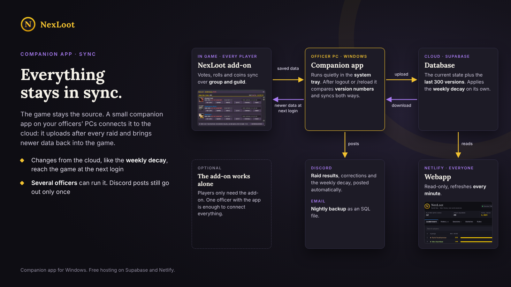
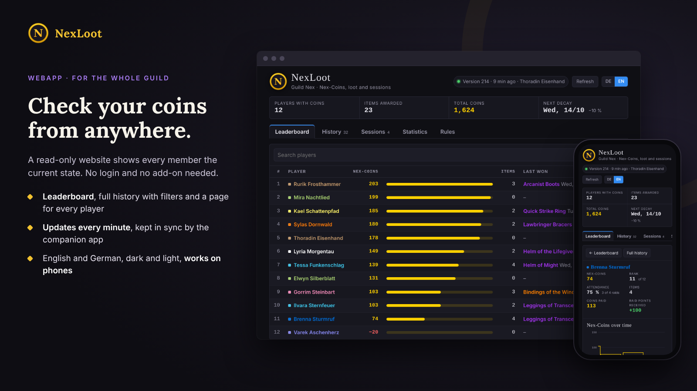
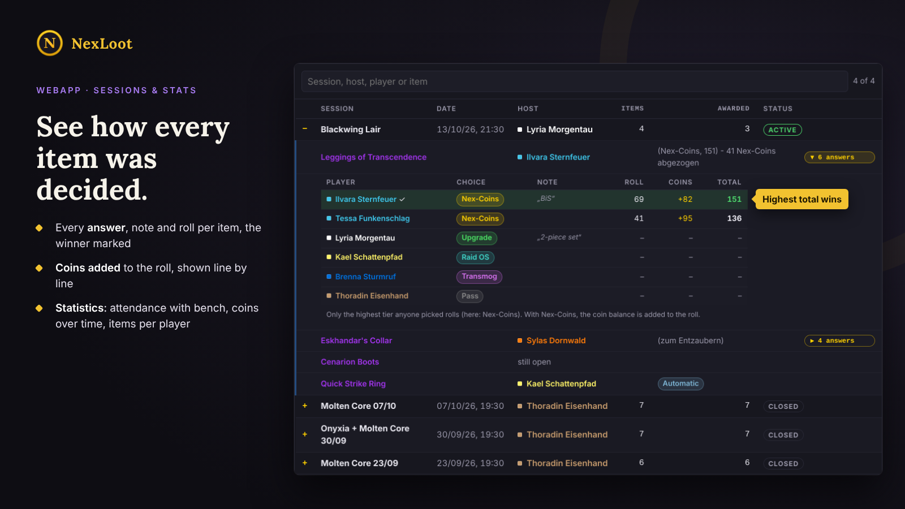
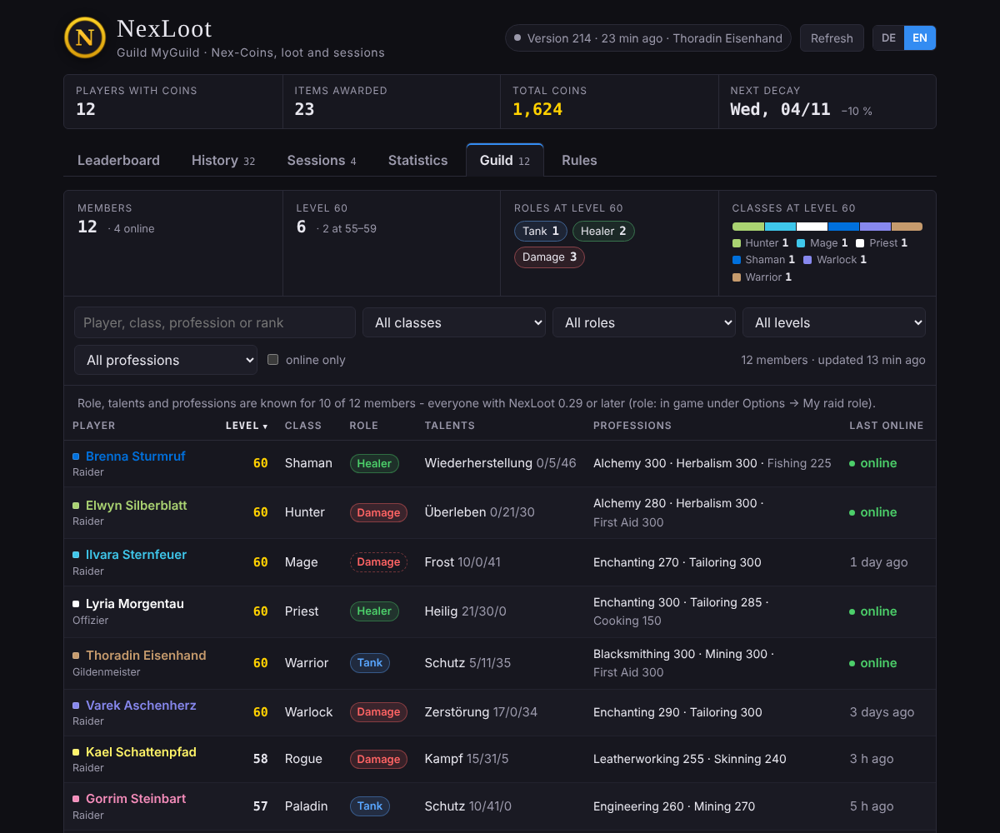
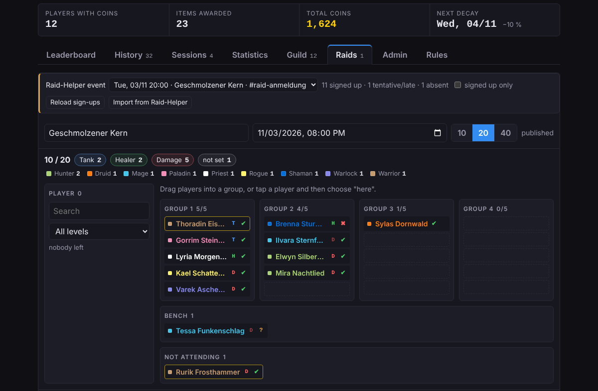

# NexLoot Companion & Webapp

A companion app and a website for the **NexLoot** raid loot add-on for World of Warcraft.



The NexLoot add-on handles voting, rolls and Nex-Coins in the game, and it works fine on its own.
This kit connects it to the web:

- **Companion app** (Windows, system tray) for officers. After every logout or `/reload` it uploads
  the add-on's saved data and brings newer data back into the game, including the published raid setups.
- **Website** for the whole guild: leaderboard, history with filters, sessions with every answer and
  roll, attendance and coin statistics, guild overview and raids. English and German, works on phones.
  Coins and loot stay read-only – they only change in the game.
- **Database** on Supabase: the current state, the last 300 versions and the weekly coin decay.
- Optional: **log in with Discord**. Players link their character and see their coins, items and their
  group for the next raid on the start page.
- Optional: **raid setups**. Officers plan the groups on the website (drag and drop, roles and classes
  counted). Published setups show up in the game (add-on 0.30: your group, invite all, sort groups) and
  on Discord in Raid-Helper style with @mentions and class icons. Past raids show who actually came.
- Optional: **Raid-Helper**. Pick the Raid-Helper event in the setup editor to see everyone's sign-up,
  send the groups to Raid-Helper's comp tool and let Raid-Helper post them – or import a line-up from
  the comp tool.
- Optional: a **guild overview** with raid planning, professions and level milestones (add-on 0.29),
  a **Discord** post after every raid and for the weekly decay, and a nightly **email backup**.

Every guild runs its own copy on free Supabase and Netlify accounts. There is no shared server,
and nobody else can reach your data.

## What you need

- The NexLoot add-on **0.26.0 or newer** for all players (**0.29.0** for the guild overview,
  **0.30.0** for raid setups in the game)
- **Windows 10 or 11** for officers who run the companion app (nothing to install, it uses the
  built-in Windows PowerShell)
- Free accounts at [Supabase](https://supabase.com) and [Netlify](https://www.netlify.com)
- Optional: a Discord application for the login, a Discord channel webhook, a Gmail app password for
  the backup, Raid-Helper (Premium recommended)

## Setup in short

1. **Database:** open `1 Supabase/nexloot.sql`, set your guild ID and a write password at the
   bottom, and run the file in the Supabase SQL Editor. Then run `nexloot_gilde.sql` and
   `nexloot_konten.sql` the same way.
2. **Website:** fill in `2 Website/config.js` and drag the folder onto
   [Netlify Drop](https://app.netlify.com/drop).
3. **Companion app:** unblock the ZIP, start `3 Companion/NexLoot Companion.bat` and fill in the
   setup. Other officers just paste the connection code you send them.
4. Optional: turn on the Discord login in Supabase (step 8 of the guide) and connect Raid-Helper
   (step 10: two Vault secrets, `nexloot_raidhelper.sql` and the edge function
   `nexloot-raidhelper.ts`).

Step by step: [GUIDE.txt](GUIDE.txt) (English) · [ANLEITUNG.txt](ANLEITUNG.txt) (Deutsch)

### Updating from an older kit

1. Run `1 Supabase/nexloot_konten.sql` in the Supabase SQL Editor (and turn on the Discord login,
   step 8 of the guide). Coming from kit 1.6.x: run `nexloot_gilde.sql` first.
2. Upload the new `2 Website/index.html` together with your filled-in `config.js`.
3. Every officer: quit the companion app, copy the new files from `3 Companion` over the old ones,
   start it again. Players: add-on 0.30.0 for raid setups in the game.

## Screenshots









## Security

- The website and the public (publishable) Supabase key can only read coins, loot and history.
- Writing needs the guild's write password. The database stores it only as a bcrypt hash.
- Discord login: players can only link their own characters. Only officers plan setups and assign
  accounts, and only the write password makes someone an officer. The Discord client secret stays
  in Supabase.
- The companion app stores the write password, the Discord webhooks and the mail app password
  encrypted with Windows (DPAPI), readable only by your Windows user. They never appear in the log.
- Raid-Helper: the API key stays in the Supabase Vault. The website, the add-on and the companion app
  never see it. The edge function gets it from the database for a single call and stores nothing.
- The secret / service_role key of Supabase is not used anywhere. Never put it into any file.
- The connection code contains the write password. Send it to officers privately only.

## Language

The companion app and its Discord posts are in German. The website has English and German.
The guide explains every German label in English.

## Contents

```
1 Supabase/nexloot.sql              database setup (run once in the SQL Editor)
1 Supabase/nexloot_gilde.sql        guild overview and milestones (run once)
1 Supabase/nexloot_konten.sql       Discord login, characters and raid setups (run once)
1 Supabase/nexloot_raidhelper.sql   Raid-Helper connection (optional)
1 Supabase/nexloot-raidhelper.ts    edge function for Raid-Helper (optional)
1 Supabase/nexloot_gilde_reset.sql  clears roster and milestones (fresh start)
2 Website/index.html                the website
2 Website/config.js                 your Supabase address, public key and guild ID
3 Companion/                        the companion app (PowerShell) and two start files
GUIDE.txt / ANLEITUNG.txt           full setup guide in English / German
```

## License

MIT, see [LICENSE](LICENSE). Free and without warranty.
Not affiliated with or endorsed by Blizzard Entertainment. World of Warcraft is a trademark of
Blizzard Entertainment, Inc. Raid-Helper is an independent service and not affiliated with NexLoot.

---

**Deutsch:** Begleit-App und Webseite für das WoW-Addon NexLoot. Die Companion-App läuft bei den
Offizieren unter Windows und gleicht den Stand aus dem Spiel mit einer eigenen, kostenlosen
Supabase-Datenbank ab. Die Webseite zeigt ihn allen an. Wer sich mit Discord anmeldet, verknüpft
seinen Charakter; Offiziere planen dort die Raid-Setups, die ins Spiel und nach Discord kommen – auf
Wunsch über Raid-Helper. Jede Gilde richtet ihr eigenes System ein. Die komplette Anleitung steht in
[ANLEITUNG.txt](ANLEITUNG.txt).
