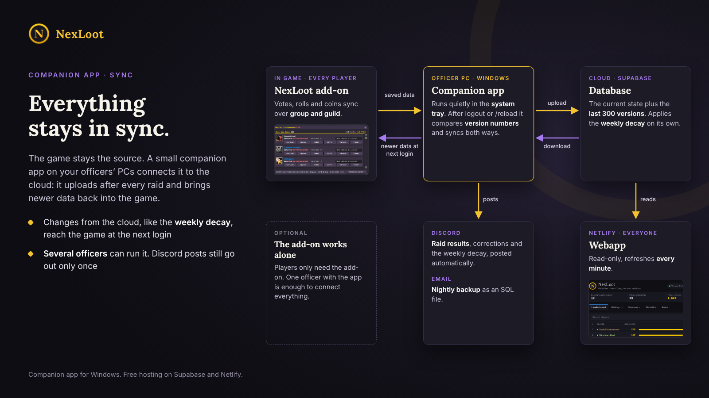
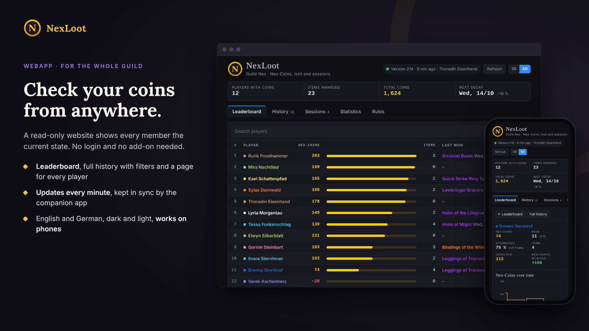
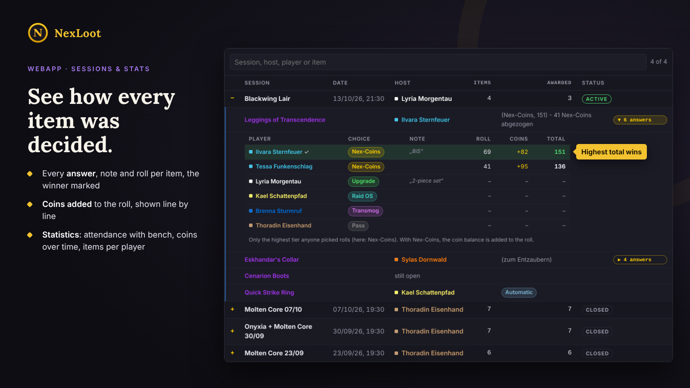

# NexLoot Companion & Webapp

A companion app and a website for the **NexLoot** raid loot add-on for World of Warcraft.



The NexLoot add-on handles voting, rolls and Nex-Coins in the game, and it works fine on its own.
This kit connects it to the web:

- **Companion app** (Windows, system tray) for officers. After every logout or `/reload` it uploads
  the add-on's saved data and brings newer data back into the game.
- **Website** (read-only) for the whole guild: leaderboard, history with filters, sessions with
  every answer and roll, attendance and coin statistics. English and German, works on phones.
- **Database** on Supabase: the current state, the last 300 versions and the weekly coin decay.
- Optional: a **Discord** post after every raid and for the weekly decay, and a nightly **email
  backup** as an SQL file.

Every guild runs its own copy on free Supabase and Netlify accounts. There is no shared server,
and nobody else can reach your data.

## What you need

- The NexLoot add-on **0.26.0 or newer** for all players
- **Windows 10 or 11** for officers who run the companion app (nothing to install, it uses the
  built-in Windows PowerShell)
- Free accounts at [Supabase](https://supabase.com) and [Netlify](https://www.netlify.com)
- Optional: a Discord channel webhook, a Gmail app password for the backup

## Setup in short

1. **Database:** open `1 Supabase/nexloot.sql`, set your guild ID and a write password at the
   bottom, and run the file in the Supabase SQL Editor.
2. **Website:** fill in `2 Website/config.js` and drag the folder onto
   [Netlify Drop](https://app.netlify.com/drop).
3. **Companion app:** unblock the ZIP, start `3 Companion/NexLoot Companion.bat` and fill in the
   setup. Other officers just paste the connection code you send them.

Step by step: [GUIDE.txt](GUIDE.txt) (English) · [ANLEITUNG.txt](ANLEITUNG.txt) (Deutsch)

## Screenshots





## Security

- The website and the public (publishable) Supabase key can only read.
- Writing needs the guild's write password. The database stores it only as a bcrypt hash.
- The companion app stores the write password, the Discord webhook and the mail app password
  encrypted with Windows (DPAPI), readable only by your Windows user. They never appear in the log.
- The secret / service_role key of Supabase is not used anywhere. Never put it into any file.
- The connection code contains the write password. Send it to officers privately only.

## Language

The companion app and its Discord posts are in German. The website has English and German.
The guide explains every German label in English.

## Contents

```
1 Supabase/nexloot.sql      database setup (run once in the SQL Editor)
2 Website/index.html        the website
2 Website/config.js         your Supabase address, public key and guild ID
3 Companion/                the companion app (PowerShell) and two start files
GUIDE.txt / ANLEITUNG.txt   full setup guide in English / German
```

## License

MIT, see [LICENSE](LICENSE). Free and without warranty.
Not affiliated with or endorsed by Blizzard Entertainment. World of Warcraft is a trademark of
Blizzard Entertainment, Inc.

---

**Deutsch:** Begleit-App und Webseite für das WoW-Addon NexLoot. Die Companion-App läuft bei den
Offizieren unter Windows und gleicht den Stand aus dem Spiel mit einer eigenen, kostenlosen
Supabase-Datenbank ab. Die Webseite zeigt ihn allen an. Jede Gilde richtet ihr eigenes System ein.
Die komplette Anleitung steht in [ANLEITUNG.txt](ANLEITUNG.txt).
